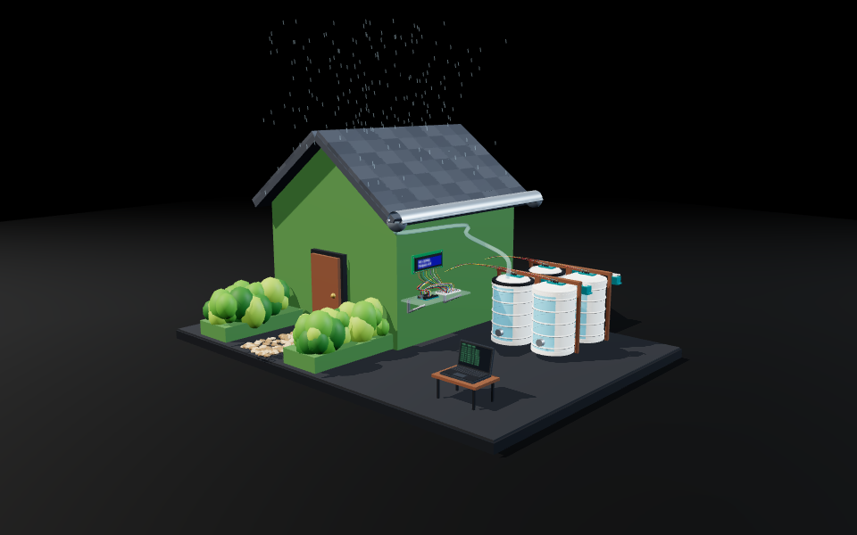

# HYDRA

**🌧 Rainwater Harvesting & Management System | IoT & Digital Twin**

An engineering project focused on automated rainwater harvesting, water monitoring, and resource management through Arduino-based control, IoT connectivity, and an interactive 3D digital twin.

---

## About the Project

HYDRA is an academic engineering project originally developed in 2025 to address water resource management through technology and automation.

The original prototype integrates sensors, microcontrollers, and automated mechanisms to monitor water levels, measure pH, and manage rainwater collection.

In 2026, the project was expanded through the development of an interactive 3D digital twin, providing a digital representation of the system and its operating principles.

## Project Goals

- Promote sustainable water resource management.
- Automate rainwater collection and storage.
- Monitor water levels and pH measurements.
- Integrate IoT technologies for remote monitoring.
- Simulate system behavior through an interactive 3D environment.
- Demonstrate the integration of hardware and software engineering.

## Technologies Used

| Technology | Purpose |
|---|---|
| Arduino UNO | Sensor monitoring and system control |
| Arduino MKR | IoT connectivity and data transmission |
| C/C++ | Embedded systems programming |
| Firebase | Cloud database integration |
| Three.js | Interactive 3D visualization |
| JavaScript | Simulation logic and interactions |
| HTML5 & CSS3 | User interface development |
| Vite | Development and production builds |

## Features

### Embedded System

- Ultrasonic water level monitoring.
- Water volume estimation.
- pH measurement.
- Automated servomotor control.
- LCD information display.
- Serial communication between microcontrollers.
- Wi-Fi connectivity and Firebase integration.

### Digital Twin

- Interactive 3D representation of the rainwater harvesting system.
- Dynamic water collection and storage simulation.
- Four interconnected storage tanks.
- Real-time simulated system indicators.
- Interactive camera controls.
- Arduino firmware visualization.
- Simulated serial monitoring.
- Modular software architecture.

## How It Works

The original system uses an ultrasonic sensor to measure water levels and estimate the volume of water collected.

An Arduino UNO processes sensor measurements and controls the automated mechanisms. An Arduino MKR handles wireless connectivity and data transmission to Firebase.

The digital twin reproduces the operating principles of the physical system through an interactive 3D environment, allowing users to explore its components and observe simulated water collection and storage.

The digital simulation operates independently from the physical hardware.

## Development Process

### Phase 01 — Research and Concept Design

Identification of water management challenges and development of an automated rainwater harvesting solution.

### Phase 02 — Physical Prototype (2025)

Development of the original Arduino-based system, integration of electronic components, sensor programming, and automation logic.

### Phase 03 — Digital Twin Development (2026)

Creation of an interactive 3D environment representing the original system and its operating principles.

### Phase 04 — Software Refactoring

Organization of the digital twin into modular components to improve code readability, maintainability, and future scalability.

## Running the Project

### Requirements

- Node.js
- npm
- Modern web browser

### Clone the Repository

```bash
git clone https://github.com/waltdev16/HYDRA.git
```

### Navigate to the Digital Twin

```bash
cd HYDRA/digital-twin
```

### Install Dependencies

```bash
npm install
```

### Start the Development Server

```bash
npm run dev
```

Open the local URL displayed in the terminal.

### Production Build

```bash
npm run build
```

### Preview the Production Build

```bash
npm run preview
```

## Project Structure

```text
HYDRA/
├── digital-twin/
│   ├── public/
│   ├── src/
│   ├── index.html
│   ├── package.json
│   ├── package-lock.json
│   └── vite.config.js
│
├── firmware/
│   ├── Hydra_Arduino/
│   │   └── Hydra_Arduino.ino
│   └── pH_MKR/
│       └── pH_MKR.ino
│
├── docs/
│   └── images/
│       └── preview.png
│
├── .gitignore
└── README.md
```

## Preview



## Future Improvements

- Live synchronization between the physical prototype and digital twin.
- Remote monitoring dashboard.
- Historical water consumption analytics.
- Solar-powered system integration.
- Advanced water quality monitoring.
- Improved physical system scalability.

## Authors

### Original Project — 2025

- Walter Santos
- Fabio Molina
- Nancy Aranivar
- Ariadna Menjivar
- Amy Mendoza
- Johana Martinez

### Digital Twin Development — 2026

- Walter Santos

---
Centro ¡Supérate! Fundación Frech
---

**HYDRA — Engineering Technology for Sustainable Water Management.**
